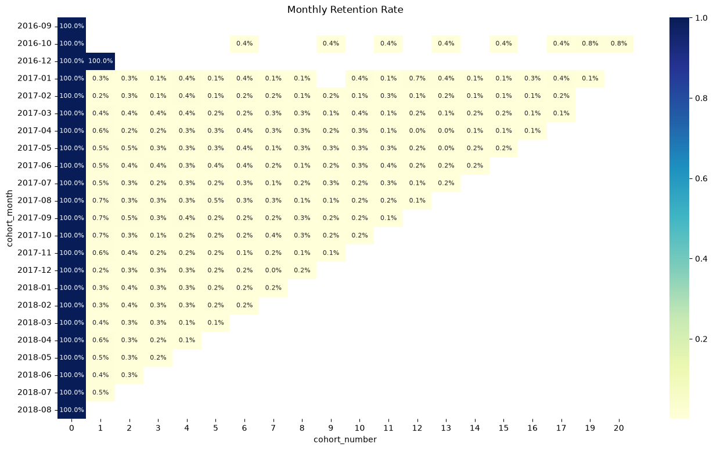
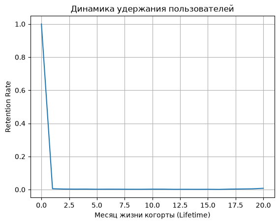
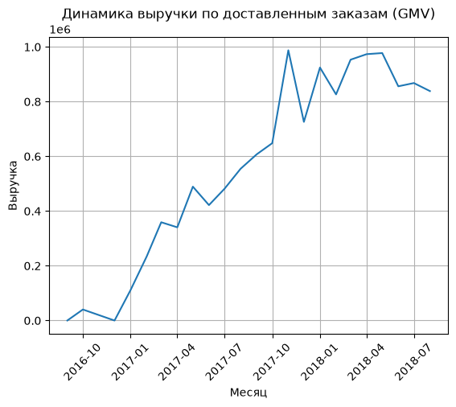
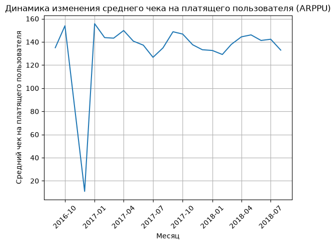

# 📊 Product Analytics & Growth Project: Анализ удержания аудитории, динамики метрик и приоритизация бэклога (Olist E-commerce)

## 🎯 Обзор проекта
Данный проект посвящен комплексному исследованию пользовательского поведения маркетплейса на основе данных **Olist**. В ходе работы был проведен глубокий продуктовый анализ для выявления причин стагнации выручки, рассчитана система ключевых метрик, проведена приоритизация бэклога по фреймворку ICE и спроектирован дизайн эксперимента для валидации критической гипотезы.

## 📋 Содержание
- [🛠 Стек технологий](#-стек-технологий)
- [📦 Используемые датасеты](#-используемые-датасеты)
- [📈 Этапы и результаты анализа](#-этапы-и-результаты-анализа)
- [📊 Визуализация метрик и архитектура графиков](#-визуализация-метрик-и-архитектура-графиков)
- [🎯 Приоритизация гипотез (ICE Framework)](#-приоритизация-гипотез-ice-framework)
- [🧪 Дизайн эксперимента (Гипотеза H1)](#-дизайн-эксперимента-гипотеза-h1)
- [⚙️ Инструкция по запуску](#-инструкция-по-запуску)

## 🛠 Стек технологий
* **Язык:** Python
* **Библиотеки анализа:** Pandas, NumPy
* **Визуализация:** Seaborn, Matplotlib
* **Продуктовая методология:** Когортный анализ, ICE Скоринг, Элементы А/В-тестирования

## 📦 Используемые датасеты
Исследование базируется на трех реляционных таблицах:
1. `olist_customers_dataset.csv` — уникальные идентификаторы и профили клиентов.
2. `olist_orders_dataset.csv` — информация о заказах, их статусах и временных метках (таймстемпах).
3. `olist_order_items_dataset.csv` — финансовые данные товарных позиций и заказов.

---

## 📈 Этапы и результаты анализа

### 1. Когортный анализ и Retention Rate
Проведен расчет ежемесячного удержания (Retention Matrix) по когортам для заказов в статусе `delivered` (реальный клиентский опыт).
* **Инсайт:** Выявлен критически низкий **медианный Retention 1-го месяца — 0.51%**.
* **Вывод:** Продукт находится в состоянии «дырявого ведра» из-за отсутствия явного Product/Market Fit (PMF). Основные средства уходят на привлечение (CAC), а не удержание (Retention).

### 2. Контроль ключевых метрик (Система 5 показателей)
Для регулярного мониторинга здоровья бизнеса настроены и визуализированы в динамике следующие метрики:
* **GMV (Gross Merchandise Value):** Объем выручки по доставленным заказам. Наблюдается резкий рост за счет притока новичков, но стремительное падение к концу периода.
* **MAU (Monthly Active Users):** Количество уникальных активных пользователей в месяц. Кривая нестабильна, постоянный органический рост отсутствует.
* **CTR (Click-Through Rate):** Процент кликабельности рекламы для оценки вовлечения новых клиентов на первом этапе.
* **Retention Rate:** Метрика вовлеченности (описана в п.1).
* **ARPPU (Average Revenue Per Paying User):** Денежное выражение вовлеченности. График имеет сильные скачки, что сигнализирует о необходимости стимулирования повторных продаж.

---

## 📊 Визуализация метрик и архитектура графиков

Ключевой акцент в анализе сделан на графическом исследовании поведения пользователей. Ниже представлены фрагменты кода отрисовки чартов, сгенерированные PNG-графики и их продуктовая интерпретация.

### 1. Матрица ежемесячного удержания (Retention Heatmap)
Генерирует тепловую карту для когортного отслеживания «Lifetime» пользователей и поиска операционных аномалий.

```python
plt.figure(figsize = (16,9))
sns.heatmap(retention_matrix, annot=True, fmt='.1%', cmap='YlGnBu', annot_kws={"size": 8})
plt.title('Monthly Retention Rate')
plt.show()
```

* **Интерпретация:** Сильное и резкое падение показателей лояльности сразу после первой покупки свидетельствует о проблемах в пользовательском опыте.

### 2. Кривая удержания (Retention Curve)
Агрегирует динамику медианного удержания клиентов для оценки сходимости к плато.

```python
median_retention = retention_matrix.median(axis = 0)
sns.lineplot(x = median_retention.index, y = median_retention.values)
plt.xlabel("Месяц жизни когорты (Lifetime)")
plt.ylabel("Retention Rate")
plt.title("Динамика удержания пользователей")
plt.grid(True)
plt.show()
```

* **Интерпретация:** Кривая стремительно падает уже в первые 1–2 месяца активности и выходит к плато около 0%. Это визуально доказывает **отсутствие Product/Market Fit**.

### 3. Тренд выручки по доставленным заказам (GMV Lineplot)
Отражает динамику масштабирования продаж в денежном выражении.

```python
sns.lineplot(x = GMV.index, y = GMV.values)
plt.xticks(rotation=45)
plt.xlabel("Месяц")
plt.ylabel("Выручка")
plt.title("Динамика выручки по доставленным заказам (GMV)")
plt.grid(True)
plt.show()
```

* **Интерпретация:** График фиксирует, что первоначальный рост GMV за счет привлечения новой аудитории сменяется падением, подтверждая критические утечки в текущих операциях.

### 4. Динамика ARPPU (Average Revenue Per Paying User)
Показывает денежное выражение вовлеченности платящей базы.

```python
sns.lineplot(data = ARPPU_df, x = 'cohort_month', y = 'ARPPU')
plt.xticks(rotation=45)
plt.xlabel("Месяц")
plt.ylabel("Cредний чек на платящего пользователя")
plt.title("Динамика изменения среднего чека на платящего пользователя (ARPPU)")
plt.grid(True)
plt.show()
```

* **Интерпретация:** Выраженные волнообразные колебания и скачки кривой на графике сигнализируют о нестабильной монетизации и отсутствии системной работы с LTV.

---

## 🎯 Приоритизация гипотез (ICE Framework)

Для ликвидации технического оттока и восстановления метрики GMV были оценены три продуктовые гипотезы с расчетом потенциального абсолютного прироста в заказах:

| Гипотеза | Impact (Влияние) | Confidence (Уверенность) | Ease (Простота) | Итоговый балл ICE | Приоритет |
| :--- | :---: | :---: | :---: | :---: | :---: |
| **H1: Исправление бага процессинга** | **4 (+499 зак.)** | **8** | **6** | **192** | 🥇 **1 место** |
| **H3: Новый способ оплаты для новичков** | 4 (+419 зак.) | 5 | 9 | 180 | 🥈 2 место |
| **H2: Сокращение опозданий логистики** | 1 (+31 заказ) | 10 | 4 | 40 | 🥉 3 место |

**Решение:** К первоочередной разработке и тестированию принимается **Гипотеза H1** как наиболее сбалансированная и эффективная.

---

## 🧪 Дизайн эксперимента (Гипотеза H1)

* **Формулировка:** «Если мы исправим баг в системе процессинга заказов, то клиенты перестанут сталкиваться с техническими отменами на этапе чекаута, вследствие чего количество доставленных заказов увеличится за счет ликвидации этого оттока».
* **Метрики эксперимента**:
  * 🟢 **Целевая метрика (Primary):** GMV (Выручка по доставленным заказам) — зафиксирует коммерческий успех релиза в деньгах.
  * 🟡 **Прокси-метрика (Proxy):** Конверсия из оформления заказа в успешную оплату (CR) — позволит мгновенно увидеть результат, не дожидаясь завершения логистического цикла.
  * 🔴 **Контролируемая метрика (Guardrail):** Доля отмен и возвратов на более поздних этапах — проверка того, что мы не пропустили «проблемных» заказы, которые увеличат расходы на логистику.

---

## ⚙️ Инструкция по запуску

1. Клонируйте репозиторий с проектом:
   ```bash
   git clone https://github.com
   ```
2. Убедитесь, что в корневой папке находятся файлы датасетов:
   * `olist_customers_dataset.csv`
   * `olist_orders_dataset.csv`
   * `olist_order_items_dataset.csv`
3. Установите необходимые библиотеки (если они не установлены):
   ```bash
   pip install pandas seaborn matplotlib
   ```
4. Запустите скрипт анализа или откройте Jupyter Notebook для просмотра графиков.

